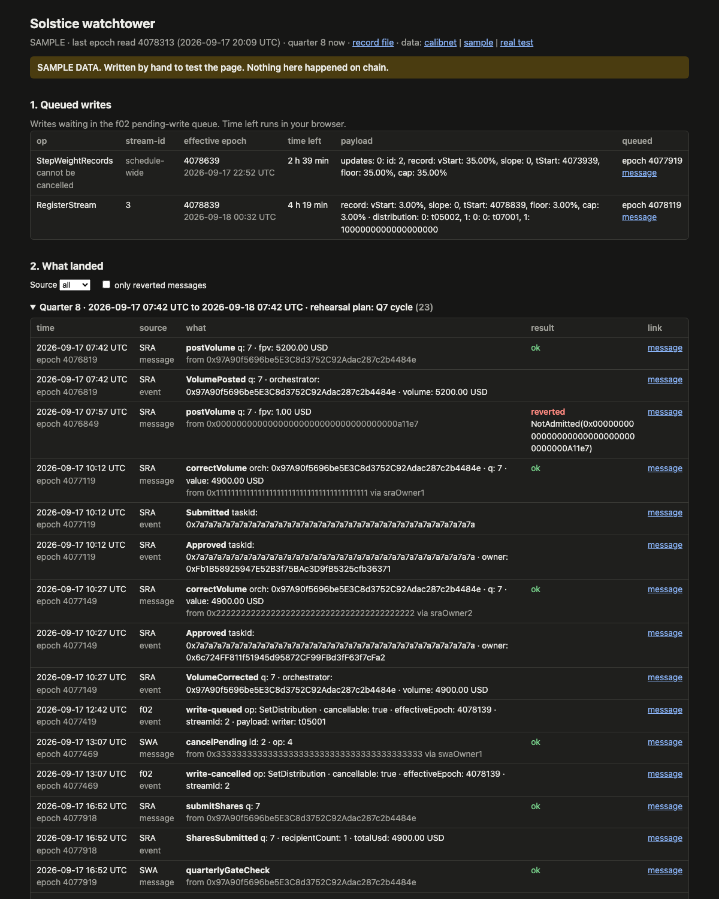

# Solstice watchtower (PoC)

Reads what landed on chain in f02, the SWA and the SRA (FIP-0118) and shows it on one page.

> **Disclaimer: this is a vibe-coded PoC.** All the code, and OBSERVABILITY.md, were written by an AI agent
> (Claude Code). Irene directed the scope and the design. William (wjmelements) looked at it on 2026-09-19 and opened
> issue #1; nobody has done a full code review. Treat what the page shows as unverified until someone checks it. What
> has been checked: 12 automated tests on hand-written samples, two records compared by hand with a block explorer, and
> one day of butterflynet test data (2026-09-21) compared with the test plan of the person who ran it (see DESIGN.md).

- Live page, hosted on Filecoin (Filecoin Pin), stable address through ENS: **https://solsticewatchtower.eth.limo/**
  Views: mainnet (default since 2026-10-16), `?data=calibnet`. The butterfly gamma view was removed on 2026-10-16 (its network is gone; the record stays in `site/data/butterfly-gamma/`). The ENS name `solsticewatchtower.eth` points to the
  current version's CID and is updated at each publish; the data stays fresh because the page fetches the record from
  this repo (`site/data/`).
- Older versions, fixed to their CID (they keep working, but show only what their view list had):

  | Published | Link | Views |
  |---|---|---|
  | 2026-09-28 (afternoon) | https://inbrowser.link/ipfs/bafybeicy5n4zdzhnycdjktlscdxxapziqdhkvq5fyuzhztwcxpxgivya5u/ | calibnet, mainnet, butterfly gamma, with the "At a glance" block |
  | 2026-09-28 (morning) | https://inbrowser.link/ipfs/bafybeicjzly5sefxz7nyhhregr3yqfojvqusaukfvegmeqz3tc5iu527nu/ | the same |
  | 2026-09-23 (second) | https://inbrowser.link/ipfs/bafybeiemqoau7laiv2dsd62oud5ir5ufzapa2gm3g3rbfgbots43traeti/ | calibnet, mainnet, butterfly gamma |
  | 2026-09-23 (first) | https://inbrowser.link/ipfs/bafybeihrtha7j3z65six4cos4ozvhi35ijiir6o4s75zengtqji5ur4ftq/ | calibnet (first deployment, 2026-09-17), butterfly gamma, butterfly alpha |
  | 2026-09-20 | https://inbrowser.link/ipfs/bafybeihk4odsbmor5dbsjtt5uk4d3yl6z4hi3nadjqtzdpqrqlp25uylye/ | the same, plus the sample and real-test views |
  | 2026-09-18 | https://inbrowser.link/ipfs/bafybeiaalkk7ullf4rrllipm3wuvry7ebv7yuzwmecmplz4iqap2th5edi/ | calibnet (first deployment), sample, real test |

  The butterfly alpha record now lives in `archive/butterfly-alpha/`; the first calibnet deployment's record in
  `site/data/calibnet-2026-09-17/` (frozen, shown at the bottom of the calibnet history).
- Scope and discussion: https://github.com/filecoin-project/solstice/issues/69
- Design and its decisions: [DESIGN.md](DESIGN.md)
- How each FIP-0118 action can be observed on chain, by anyone: [OBSERVABILITY.md](OBSERVABILITY.md)

*The page with SAMPLE data, written by hand to test it. Nothing in this screenshot happened on chain. The SRA and
the SWA were deployed on calibnet on 2026-09-17 and redeployed on 2026-09-22; the network upgrade that activates FIP-0118 there is on
Mon 2026-09-28 13:00 UTC. Until then the real record holds the deployment events and the reads, and f02 has no queue. The
"sample" and "real test" views were removed from the page on 2026-09-22; the real views are calibnet and the two butterflynet test networks.*

A scheduled job (`.github/workflows/read.yml`) runs the reader every 15 minutes (started by an outside timer) and commits the records to
`site/data/calibnet/`, `site/data/mainnet/` and `site/data/butterfly-gamma/`. The reader only reads from a public endpoint and holds no key.

The same job ends with a backup cranker (`bin/crank.js`, since 2026-10-08): on calibnet it sends `submitShares(q)` and
`quarterlyGateCheck()` when a call has been possible for 30 minutes and nobody sent it, so the primary cranker
(https://github.com/decentramike/solstice-cranker) goes first. It needs the repository secret `CRANK_KEY` (a calibnet
account used for nothing else); without it, it only simulates. A second step (`bin/claim.js`, since 2026-10-12) sends
the f02 `Claim` once a day for every wallet that has something to collect; its key is the secret `CLAIM_KEY`, an f1
account. Both steps also run for mainnet (secrets `CRANK_KEY_MAINNET`, `CLAIM_KEY_MAINNET`; dry runs until the
secrets exist). Details in DESIGN.md.

Needs Node.js 22 or newer.

| Command | What it does |
|---|---|
| `npm install` | Installs the two libraries (`viem`, `@ipld/dag-cbor`). Once. |
| `npm run read` | One run of the reader against calibnet. Only reads from the public RPC endpoint. Appends to `site/data/calibnet/records.jsonl`. |
| `npm run sample` | Writes a SAMPLE record to `site/data/sample/` for local development (`?data=sample` is no longer linked from the page). |
| `npm run page` | Serves the page at http://localhost:8000 (sample view: http://localhost:8000/?data=sample). Stop with Ctrl+C. |
| `npm test` | Runs the decoder tests on hand-written sample inputs. |

The contract addresses and the activation epoch in `config/calibnet.json` come from solstice `deployments.json`.

## Ownership handoff to FilOzone

The page source is prepared to fetch records from `FilOzone/solstice-watchtower`. **Do not publish this page
or update ENS until the repository has been transferred and the destination serves the expected `site/data/`
files.** The currently published CID keeps its existing data URL until the page is republished.

For the cutover, pause the outside timer and scheduled workflow, let active or queued runs finish and commit,
and preserve the latest records and matching `status.json` files, including pending writes and Slack notifications.
Also preserve `site/data/calibnet/crank.json`, which records how long a call has been possible. Resume only one
writer after checking the destination's Actions permissions, timer authorization and repository secrets.

After these changes are on `main`, manually run the `read` workflow with **`skip_crank: true`** to check the reader
without invoking the transaction-sending cranker. This still reads RPC endpoints, commits updated records and
can post normal Slack notifications; `test_slack: true` additionally sends a marked test message. It is not a
dry run. `skip_crank` defaults to `false`, preserving scheduled runs and existing timer dispatches.

Before publishing, verify that every live network's records and cursor are current at the destination. After
publishing and updating ENS, check that the page reports `record from the repo`, rather than the bundled copy.
Keep the previous CID and data URL for rollback; reverting ENS alone does not restore the old timer or data source.
